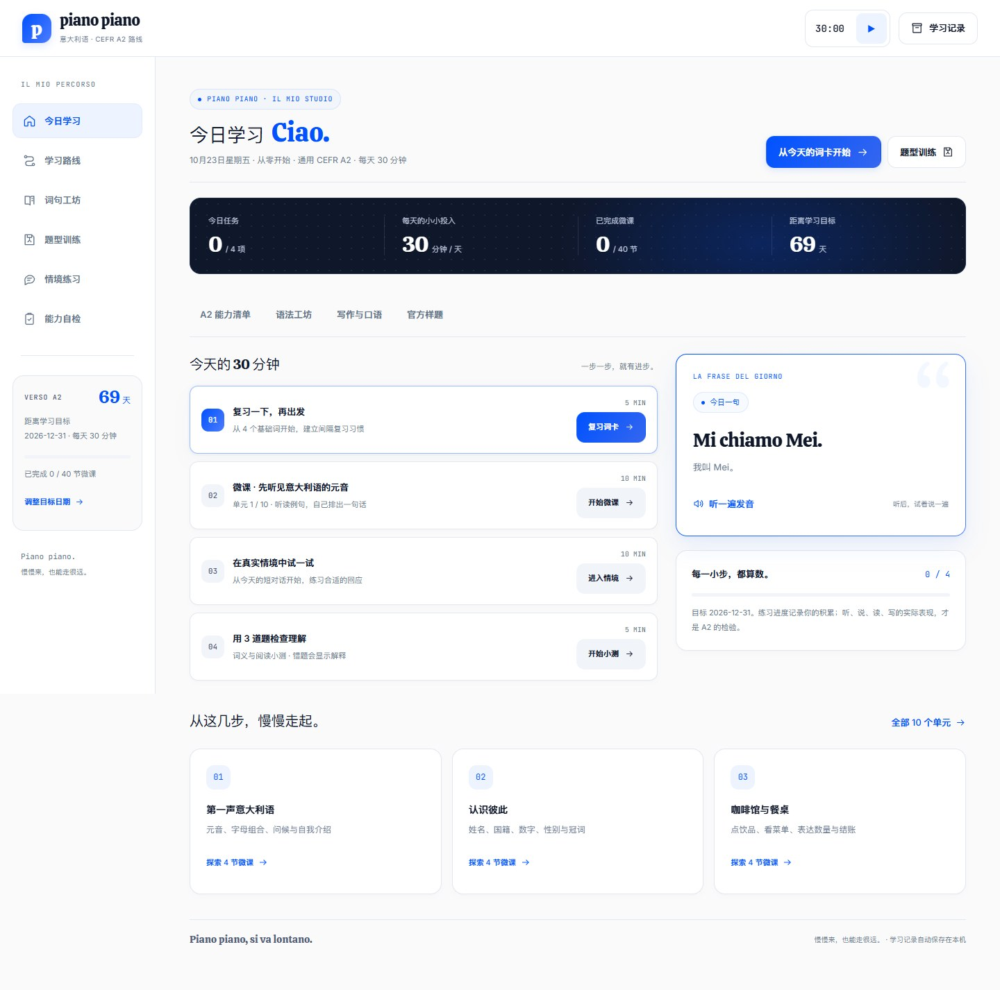
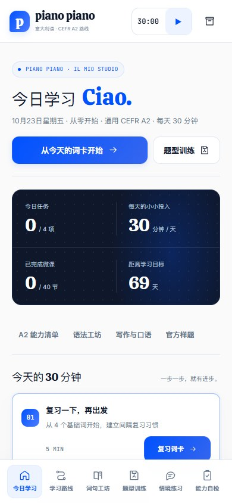

# piano piano · 意大利语 A2

一个面向中文使用者的单文件意大利语互动学习工具，从零基础按通用 CEFR A2 方向练习。页面围绕“每天约 30 分钟、今年年底前建立可迁移的生活沟通能力”设计，适合先建立学习习惯，再根据最终选择的证书补充专项备考。

## 页面包含什么

- **40 节微课**：从元音、问候、自我介绍开始，逐步进入日常会话、句子构成、过去时和实际生活交流。
- **158 个词句**：搜索、筛选、浏览器语音朗读、加入词卡。
- **间隔复习**：先回想再翻面；“再学一次 / 有印象 / 记住了”会结合连续回忆、难度和遗忘次数安排下一次复习。旧记录中的 `due`、`interval` 和 `reviews` 可以继续使用。
- **四类专项题型**：阅读理解、选词填空、信息匹配、听力理解，每类 4 题，共 16 题。填空支持键盘输入，匹配使用下拉选择；答错可重试，首次结果会保留。
- **18 个语法专题**：用咖啡馆、家庭、问路、过去经历等场景解释冠词、配合、动词、代词、介词和连接词。语法应用是独立题库，不会混入四类专项题型统计。
- **24 项 A2 能力清单**：把听、说、读、写能力关联到微课、题型和输出任务，记录“未做 / 需要提示 / 能独立完成”。
- **8 个写作与口语任务**：介绍自己、日常、邀请、订房、周末经历、看病、改约和购物问题。写作支持草稿、字数范围、信息清单、有限规则提示；口语提供 30–60 秒计时和自评，不录音、不自动评分。
- **官方样题入口**：分别链接 CILS A2、PLIDA A2、CELI 1 官方资料页，并保存练习状态和薄弱点备注。
- **错题与备份**：微课、情境、专项题、语法和写作规则会进入错题回练；记录只保存在当前浏览器，可导出或恢复 JSON。

## 使用方法

直接双击 [index.html](index.html)，或用最新版 Edge / Chrome 打开。页面没有外部运行时依赖，课程、样式、练习数据和交互都在这一个 HTML 文件里。

推荐每天完成：

1. 5 分钟到期词卡：先说意思，再翻面并选择记忆情况。
2. 10 分钟微课：听读例句，完成词序和小测。
3. 10 分钟情境或输出：在服务、出行、邀约等场景中主动表达。
4. 5 分钟专项题：轮换阅读、语言运用、匹配和听力。

如果当天时间更少，优先做一轮到期词卡和一个输出任务。能力清单用于决定下一步练什么，不用于推算证书通过率。

## 备考边界

本页按通用 CEFR A2 能力方向组织，题目和示例均为本项目原创练习，不是 PLIDA、CILS 或 CELI 的官方真题，也不复制第三方课程或整套受版权保护的试卷。官方样题入口只负责打开来源页面和记录你的练习备注。

“2026-12-31”是可编辑的学习目标日期，不是已经核实的考试日期。上海考点、场次、报名截止时间、费用和报考条件需要在确定证书后，向对应考试机构及授权考点核对。

口语使用自评，听力练习默认调用设备提供的意大利语合成语音；真正参加考试前，应加入所选机构的真人听力、限时整套模拟和评分规则练习。

## 参考资料

- [欧洲委员会 · CEFR 等级描述](https://www.coe.int/en/web/common-european-framework-reference-languages/level-descriptions)
- [CILS A2 Standard 官方页面](https://cils.unistrasi.it/1/89/196/Prove_Liv._A2_standard.htm)
- [PLIDA 官方网站](https://plida.dante.global/)
- [CVCL · CELI 官方网站](https://www.cvcl.it/)
- [SuperMemo · SM-2 复习算法说明](https://super-memory.com/english/ol/sm2.htm)
- [Busuu · 间隔复习与主动回忆](https://www.busuu.com/en/languages/spaced-repetition)

## 本地验证

当前版本已验证：

- `node --check` 通过；
- 40 节微课、158 个词句、18 个语法专题、8 个输出任务和 24 项能力清单加载；
- 四类专项题各保持 4 题，共 16 题；
- 桌面路由和 390px 手机路由无横向溢出；
- 语法答错、订正、刷新恢复和错题解除；
- 写作字数、规则提示、信息清单、口语倒计时和刷新恢复；
- 官方样题状态与备注保存；
- 旧版闪卡记录迁移，新版 JSON 导出与恢复；
- 本地 HTTP 及 `file://` 直接打开，浏览器控制台无错误。

## 许可

项目代码使用 MIT License。页面内嵌字体的授权说明保留在 HTML 末尾的 `font-licenses` 模板中。
